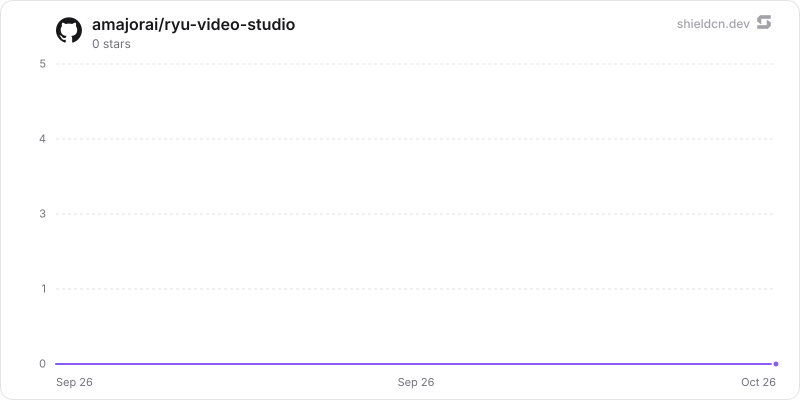

<div align="center">

# video-studio

</div>

Edit layered video timelines, review storyboards, add timed captions, and render finished videos on a Ryu node.

> **The public home of `ryu-video-studio`.** Source, builds, and releases live here —
> binaries for every platform are attached to each release.
>
> This tree is generated from the Ryu monorepo, so commits pushed here
> directly are replaced on the next sync. **Pull requests are welcome** —
> open them here and they are ported into the monorepo, then flow back out.
> Ryu as a whole: https://github.com/amajorai/ryu

## Install

**App:** [Install](ryu://apps/com.ryu.video-studio) (opens the Ryu desktop app and asks you to confirm)

**CLI:**

```bash
ryu apps add com.ryu.video-studio
```

## Source & build

The **source of record** for this app: a Bun/TypeScript
`sidecar/` Ryu runs locally as a grant-gated control capability, plus the
manifest `ui/`. The sidecar builds standalone — `cd sidecar && bun install &&
bun run build` compiles a single `ryu-video-studio` executable; each release attaches
the per-platform binaries.

## License

Apache-2.0 — see [LICENSE](./LICENSE).

## Feature map (parity waves 0–5)

The full-parity programme added the features below. Public behaviour is
documented in the Video Studio pages of the Ryu docs (timeline editing,
workspace, color/effects/motion, audio, assisted editing, media workflows,
transcripts and captions, generation, finishing, export, shortcuts, agents).

- **Limits** (`shared/limits.ts`): 32 tracks (0–31), 5000 clips, 1000 titles and
  1000 graphics, canvas up to 8192 px (presets stay within 3840), 2 h projects.
  Frame rates 23.976, 24, 25, 29.97, 30, 48, 50, 59.94, 60, 120 with exact NTSC
  timebases in render, FCPXML and XMEML (`shared/frame-rate.ts`).
- **Timeline** (`shared/cut-ops.ts`, `clipboard.ts`, `timeline-snap.ts`,
  `sync-lock.ts`, `overwrite.ts`, `overlay-edits.ts`, `markers.ts`,
  `ui/src/timeline/`): razor, split and trim to playhead (Q/W, Alt+Q/W), ripple
  delete and ripple-delete-gap, ripple mode, select forward, marquee, clip
  clipboard with paste insert and grouped paste settings, snapping (N), zoom
  5–600 px/s, timecode go-to, loop and play-around, J/L shuttle 1–8×, track
  hide/sync lock/height/add/remove, drag-and-drop overwrite/insert with drop
  preview, group drag and trim, fade handles, marker editor and panel,
  filmstrips, waveforms, labels and colours, clip context menu, overlay lanes,
  slip two-up viewer, recover detached audio.
- **Keyframes** (`shared/keyframe-*.ts`, `shared/animation.ts`): six
  interpolation types including CSS-style bezier, 25 keyframable properties,
  keyframe copy/paste, keyframe lanes, graph editor, volume line.
- **Workspace** (`ui/src/workspace/`, `ui/src/editor/`, `ui/src/shortcuts/`):
  history panel, autosave, rebindable shortcuts dialog (`shortcuts/defaults.ts`
  is the key map), resizable panels with presets and maximize, first-run tour,
  NumberField expressions and scrub, projects dashboard and recent-project
  strip.
- **Look** (`shared/blend.ts`, `masks.ts`, `keying.ts`, `color-advanced.ts`,
  `cube-lut.ts`, `color-looks.ts`, `effects.ts`, `adjustment.ts`,
  `background.ts`, `layouts.ts`, `reveal-transitions.ts`, `clip-animation.ts`,
  `shape-geometry.ts`): 20 blend modes, flip, Scale X/Y, fit/fill/stretch, 4
  masks per clip (9 shapes), chroma/colour/HSV/luma keys with despill and
  eyedropper, static-background cutout, tone/wheels/curves/HSL, `.cube` LUTs,
  12 looks, 24 effects, adjustment layers, canvas and clip backgrounds with blur
  fill, 24 reveal transitions, exit transitions, in/out/loop clip animations,
  extra shapes, on-canvas transform, crop mode and inline text edit.
- **Audio** (`shared/audio-effects.ts`, `clip-speed.ts`, `track-mix.ts`,
  `soundtrack*.ts`, `sfx.ts`): cleanup presets, RNNoise voice isolation, 16
  audio effects with 8 presets, pan and channel modes, speed 0.1–100× with
  preserve-pitch, per-track gain/pan mixer, master meter, scrub audio, 9-style
  planned procedural soundtrack, 8 procedural SFX, voiceover/screen/camera
  recorder (`ui/src/panels/RecorderPanel.tsx`).
- **Export** (`shared/render-options.ts`, `publish-presets.ts`,
  `output-resolution.ts`, `sidecar/src/render-chunks.ts`): MP4, MOV, WebM, GIF,
  WAV, MP3, AAC, PNG/JPEG sequences; alpha exports; range, audio, rate control,
  encoder speed, output resolution tiers (720p/1080p/2K/4K keeping the canvas
  aspect) or a custom size, save to library; 8 publish presets with `metadata.txt`; chunked export
  for long timelines.
- **Media** (`sidecar/src/proxy.ts`, `stabilize.ts`, `interpolate.ts`,
  `matte.ts`, `lottie-encode.ts`, `relink.ts`, `shared/stickers/`): preview
  proxies, stabilize, interpolate and smooth slow motion, enhance upscale,
  colour mattes, Lottie import, offline media and relink, bundled stickers.
- **Analysis and AI** (`shared/beat-detect.ts`, `vad.ts`, `speakers.ts`,
  `sync.ts`, `multicam.ts`, `caption-*.ts`, `text-style.ts`,
  `text-templates.ts`, `timeline-transcript.ts`, `shot-index.ts`,
  `media-search.ts`, `generation.ts`, `avatar-lipsync.ts`, `nest.ts`,
  `templates.ts`, `template-library.ts`, `gap-fill.ts`, `script-to-video.ts`,
  `auto-edit.ts`, `reframe.ts`, `tracking.ts`): beat detection, VAD dead air,
  speaker detection, sync drift and multicam mic/layout switching, text styling
  and 23 text templates, 12 caption presets with rechunking and ASS/SSA import,
  timeline transcript with retake detection, visual shot search, scopes and
  timeline overview, Ask agent handoff, AI image edit/regenerate/references,
  avatar lip-sync, nest/decompose, project templates (8 built-ins), AI gap fill,
  script to video, AutoCut and vertical shorts, auto reframe, motion tracking.

### Bundled asset licences

- Title fonts in `sidecar/assets/fonts` and `ui/src/fonts`: SIL Open Font
  License or Apache 2.0 (licence texts alongside).
- `sidecar/assets/rnnoise/somnolent-hogwash.rnnn`: GregorR/rnnoise-models,
  BSD 3-Clause (RNNoise).
- Stickers (`shared/stickers/LICENSES.md`): Twemoji 15.0 (CC-BY 4.0, "Twemoji
  graphics by Twitter, Inc and other contributors, licensed under CC-BY 4.0."),
  flag-icons 7.5.0 (MIT), and original shapes.

### Out of scope (local equivalent shipped)

AI person matting (chroma/HSV/luma keys, static-background cutout, masks);
photoreal lip-sync and talking heads (vector avatar lip-sync); video-to-video,
image-to-video and first/last-frame video (AI image edit and still gap fill);
generative music (planned procedural score and SFX); ML super-resolution
(enhance chain); vision-semantic search (shot metadata index); generative
outpaint for reframe (blur fill); neural single-mic diarization (mic dominance
and clustering); direct publishing (publish presets with metadata); licensed
template, sticker, music and effect stores (built-ins and bundled sets).

## HTTP routes and grants

`manifest.json` declares one route (method, path, permission level) for every
sidecar handler: the built-in handlers in `sidecar/src/server.ts` and every
route module registered in `sidecar/src/routes/index.ts`. `GET /openapi.json`
on the sidecar documents each of them. `verify-package.ts` and
`sidecar/src/openapi.test.ts` fail when a handler has no manifest route, a
route has no handler, or a route is declared twice. GET routes and read-only
plan routes (`split-edit-plan`, `filler-plan`, `dead-air-plan`, `highlights`,
`soundtrack-plan`, `audio-window`) need `video-studio.view`; scene approval needs
`video-studio.approve`; every other route needs `video-studio.edit`.

Aliases keep planned paths working: `POST /templates/:id/instantiate` is
`POST /template-instances` with the template id in the path, and
`POST /projects/:id/captions/rechunk` and `/captions/import` are
`caption-rechunk` and `caption-import`.

Optional host grants (explicit per-app approval; never needed to enable the
app):

- `chat.sendFollowUp`: "Ask agent" sends a question about the selected range
  into an existing Ryu chat. Without it the panel explains that the host has not
  granted chat access.
- `media:record`: the voiceover recorder uses the host microphone recorder.
  Without it the recorder explains that capture is unavailable. The current
  Gateway grant policy approves this grant only for its first-party recorder
  app, so approval for Video Studio is denied until that policy changes.
- `usage:audit`: per-project budget audit receipts.

The language chosen for source transcription is stored on the transcript and
passed to the host `media.transcribe` bridge, which forwards it to engines that
accept a language hint.

## At rest

`studio.sqlite` seals each content row as one `encb:v1:` JSON document with the
`@ryu/video-studio` plugin subkey (ChaCha20-Poly1305, store `studio.sqlite`, AAD bound to
the row id; history rows bind `(project_id, revision)`): `projects`, `history`,
`transcripts`, `search_indexes` (transcript text), `generation_jobs` (prompts and
rationale) and `analyses`. Schema version 6 lifts `generation_jobs.status` and
`generation_jobs.project_id` into plaintext columns (ALTER TABLE, backfilled from the
JSON before sealing) so restart recovery and per-project lists no longer use
`json_extract`; lists order by rowid as before. `assets` (names, kinds, durations, file
references), render `jobs` and `project_meta` (creation times) stay plaintext. `media/`,
`imports/`, `renders/`, `posters/` (cached project poster frames), `fonts/` and `luts/`
(imported fonts and LUTs) and `shots/` (shot statistics, vision captions and their Spaces
projection state) are plaintext files, owner-only (folders 0700, files 0600, narrowed on
every store open without following symlinks): multi-GB media that ffmpeg reads many times
is not sealed, and the shot files are not sealed yet. While a job
runs, its work files hold plaintext copies of sealed text (`renders/<job>/captions.ass`
with caption and title text, rendered frames, `audio-window-*` folders, `tmp/probe-*.json`)
and are deleted when it ends; after a crash, every work folder under `renders/`, every
`audio-window-*` folder and every `tmp/probe-*.json` is deleted when the store opens
(lstat, symlinks removed and never followed). Finished exports and their thumbnails stay.

The key is captured before anything spawns (`capturePluginKeys`, sidecar grant
`crypto:seal`), and every key-carrying variable is removed from the environment, so
ffmpeg, probes and workers never inherit one. Existing plaintext rows are sealed on open
(cursor pagination, compare-and-swap, resumable, idempotent), then the WAL is truncated
and the database compacted when disk space allows. Lists skip and count a row that does
not open (`sealing.unreadableRows` in `GET /capabilities`); a direct read fails
(`503 DATA_UNREADABLE`), and generation budget checks fail rather than under-count. A
store sealed under a different key refuses writes (`503 SEALING_UNAVAILABLE`). Under an
older Core that delivers no key, a never-sealed store stays plaintext
(`sealing: "waiting for a Ryu update"`). Run standalone, the sidecar uses
`RYU_MASTER_KEY` or generates `<data dir>/secrets/standalone-root.key` (0600).

## Build in the Ryu workspace

```sh
bun apps-store/video-studio/build.ts
```

This builds the Companion to `dist/index.html` and the native sidecar executable
under `sidecar/dist/`, with its runtime assets (bundled fonts and the RNNoise
model) in `sidecar/dist/assets/`. Satellite releases ship the whole
`sidecar/dist/` tree as `ryu-video-studio-<platform>.tar.gz` beside the bare
executable. Install the app through Ryu's normal package lifecycle.
The manifest's `RYU_VIDEO_STUDIO_BIN` override can point at the built sidecar for
a local development node. Core supplies the extension token and sidecar port.
The app is opt-in and does not require Shadow or Clips.

The node needs FFmpeg and ffprobe on PATH. Title and caption burn-in require the
subtitles filter (libass). `RYU_VIDEO_STUDIO_FFMPEG` and `RYU_VIDEO_STUDIO_FFPROBE` can point
to explicitly installed binaries. The renderer only opens allowlisted media
formats from the app-owned library; it does not accept arbitrary command lines,
filter scripts, or output paths from clients.
Agents can import one local file, HTTPS URL, or bounded inline payload through
`POST /assets/import`; the sidecar probes it, copies it into app-owned storage,
and returns durable metadata before it can be placed on a timeline.
`GET /assets/:id/inspect` combines that metadata with any saved transcript,
source analysis, and thumbnail evidence for agent review.

Stock search covers Archive.org, Wikimedia Commons, NASA Images and Video,
keyless Openverse images/audio, node-configured Unsplash images, and optional
Pexels and Pixabay video catalogs. Unsplash, Pexels, and Pixabay access is
configured on the node; API credentials are never
exposed to the Companion, and unavailable configuration is reported instead of
falling back to another provider.

## Verification

```sh
bun test apps-store/video-studio/sidecar/src/studio.test.ts
bun test apps-store/video-studio/shared
bun test apps-store/video-studio/sidecar/src/split-edits-api.test.ts
bun apps-store/video-studio/sidecar/src/verify-split-edits.ts
bun apps-store/video-studio/sidecar/src/verify-ducking.ts
bun apps-store/video-studio/sidecar/src/verify-codecs.ts
bun apps-store/video-studio/sidecar/src/verify-media.ts
bun apps-store/video-studio/verify-package.ts
bun run --cwd apps-store/video-studio/sidecar check-types
bun run --cwd apps-store/video-studio/ui check-types
bun run check:app-ui
```

The standalone media integration check generates a real video with audio,
imports it through the authenticated API, trims it, burns captions, renders an
MP4, checks its metadata and delivery review, and retrieves its bytes. It runs outside `bun test`
because Bun 1.3.14 on this macOS host returns empty subprocess output under its
test runner, including for `/bin/echo` and `ffprobe -version`.

`verify-split-edits.ts` renders a J-cut between two tone sources through the
real export path and measures that the incoming tone starts 0.5 s before the
picture cut. `verify-ducking.ts` exports a tone bed set to duck under a voice
tone and measures that it dips by the set amount and goes down and comes back
in the set attack and release times.

For interactive verification of the compiled Companion with the real sidecar,
run `bun apps-store/video-studio/ui/e2e/proof-host.ts`, then open `http://127.0.0.1:5185`. This is a localhost test host using an isolated
`/tmp/ryu-video-studio-proof` library; it does not impersonate a live Ryu node or
provide fabricated generation results. The bridge is confined to the test host.

## Evidence and remaining scope

The requirement inventory and current limitations are tracked in the internal
`docs/video-editing-parity.md`, including the final gap matrix against Palmier
Pro, OpenCut, and CapCut (implemented, local equivalent, or out of scope with
the reason). No reference implementation, artwork, prompts, or skills
have been copied into this app.

### Native lifecycle verification

`ui/e2e/verify-core.ts` exercises an isolated Core install and enable path
through the compiled-in Core-tier builtin: it installs the builtin from Core's
catalog, enables it through the node's normal Gateway grant check, and proves
the sidecar spawn, the authenticated proxy, and a project create and reload.
Core-tier apps run their managed sidecar without a `sidecar:process` grant, so
the manifest does not request one. Run it against a freshly built
`target/debug/ryu-core` and the compiled sidecar with `RYU_PROFILE=dev
RYU_KEYCHAIN=off` and an isolated `RYU_DIR`. Do not use stub grant validation
or a tier change. The unsigned local `plugin.bundle.json` is only used when
Core does not list the builtin; that Community-tier path cannot run the
sidecar. The release-signed marketplace bundle is verifiable only in the
release pipeline. The compiled-service harness is independent evidence of the
editor and media engine.

### Local speech proof

The optional Core speech harness uses the installed Homebrew whisper.cpp server
and a Whisper tiny.en model from the upstream whisper.cpp model repository. It
runs a real isolated Core transcription route and uses an OS sandbox that permits
loopback networking only, preventing unrelated first-run model downloads. It does
not change Gateway grants or make native Video Studio activation pass.

Prepare the spoken WAV fixture and model under the paths named by
`ui/e2e/core-speech-host.ts`, then run `bun apps-store/video-studio/ui/e2e/verify-speech.ts`.
For browser verification, set `RYU_VIDEO_STUDIO_PROOF_STT=1` when starting the
compiled-service `proof-host.ts`. The browser bridge then calls real Core speech
services. This harness is macOS-specific; it is not a product runtime dependency.

## Star History

<a href="https://github.com/amajorai/ryu-video-studio/stargazers">
  <picture>
    <source media="(prefers-color-scheme: dark)" srcset="./.github/shieldcn/star-chart-dark.svg" />
    
  </picture>
</a>
